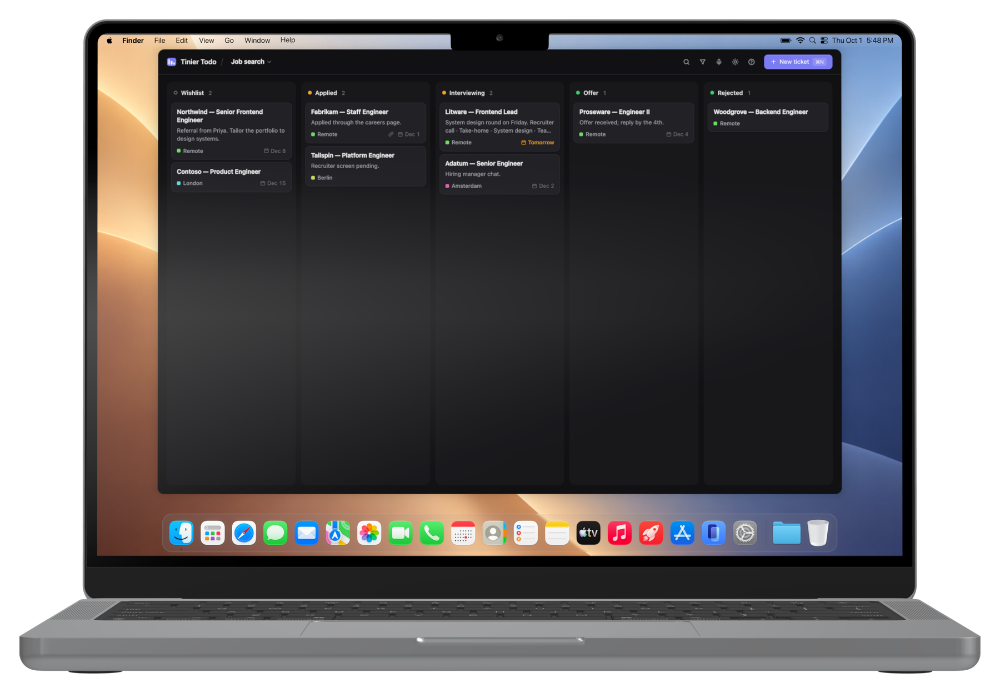
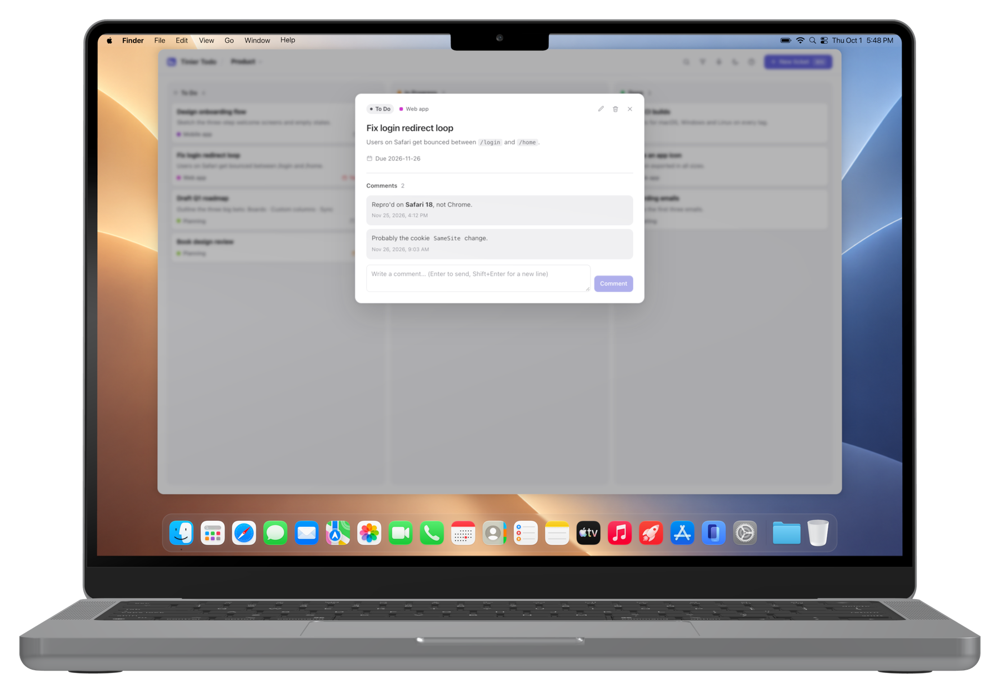

# Tinier Todo

A small, fast Kanban todo app for the desktop: multiple boards, drag and drop, filters, deadline
reminders, Markdown notes, drafts that survive closing a dialog by mistake, and an optional local MCP
server so AI assistants can read and update your boards. Built with Go, [Wails](https://wails.io),
React and TypeScript, and runs on macOS, Windows and Linux.


| Your own columns, in dark mode | Ticket details |
|---|---|
|  |  |

## Download

Get the latest build from the [Releases page](../../releases/latest).

| Platform | File |
|---|---|
| macOS (Apple silicon and Intel) | `Tinier-Todo-macOS-universal.zip` |
| Windows 10/11 | `Tinier-Todo-Windows-x64-setup.exe` (installer) or `-portable.zip` |
| Linux x64 | `Tinier-Todo-Linux-x64.tar.gz` |

The builds are not code-signed yet, so your OS will warn you the first time:

- **macOS:** unzip, move **tinier-todo.app** to Applications, then right-click it and choose **Open**.
  If macOS says the app is damaged, run `xattr -dr com.apple.quarantine /Applications/tinier-todo.app`.
- **Windows:** on the SmartScreen prompt, click **More info**, then **Run anyway**.
- **Linux:** needs GTK 3 and WebKitGTK 4.1 (`sudo apt install libgtk-3-0 libwebkit2gtk-4.1-0` on
  Ubuntu/Debian). Extract the archive, then run `./tinier-todo`.

## Features

- **Boards:** keep separate boards (work, home, side projects…). Switch with Ctrl+1 to Ctrl+9 or the
  board menu, and move a ticket to another board from its edit form
- **Your own columns:** each board has its own columns: To Do / In Progress / Done by default, or
  start from a template (Job search: Wishlist, Applied, Interviewing, Offer, Rejected; Writing;
  Reading) and rename, add, remove or reorder them with *Boards → Edit Columns…*. Columns marked
  *finished* get no deadline reminders. Removing a column moves its tickets to the column before it
- **Drag to reorder:** drag tickets between columns or up and down within one; a line shows where
  they'll land. From the keyboard, Alt+↑/↓ moves the focused ticket
- **Quick add:** hover a column and click *+ Add ticket* to add one by title alone; Enter adds it
  and leaves the field open for the next
- **Tickets:** only a name is required; add a description, project, deadline, link and comments as
  needed. Descriptions and comments support Markdown (bold, italic, lists, task lists, links, code).
  Comments can be edited and deleted
- **Filters:** by project and by deadline (overdue, due today, due within 7 days, no deadline), from
  the filter button or by clicking a project on a card
- **Search** across titles, descriptions, projects and comments, forgiving a typo in longer words
- **Deadline reminders:** a system notification for tickets due today or overdue, once a day per
  ticket while the app is open (*Tools → Settings*)
- **Drafts:** whatever you type in a new ticket, an edit or a comment is saved as you go. Close the
  dialog by mistake (or quit, or crash) and it comes back next time, with a *Discard draft* option.
  Clicking outside a form with unsaved typing no longer closes it
- **Soft delete:** deleted tickets can be restored from *Tools → Deleted Tickets*
- **Dark mode** (Ctrl+D)
- **Voice input (macOS):** dictate a ticket description with the system's speech recognition, which
  the macOS web view provides. The Windows and Linux web views don't support it; on Windows, Win+H
  (Windows voice typing) works in any text field instead
- **Import and export** (*File* menu): a board as Markdown or CSV, a JSON backup of every board, and
  tickets from a CSV file (e.g. from a spreadsheet). CSV files open correctly in Excel, and Excel's
  own CSV files import whatever their encoding or separator (`,` or `;`)
- **Native menus**, keyboard-first navigation, and the window remembers its size and position
- **Local MCP server** so AI assistants can manage your tickets (see below)
- **Plain JSON storage:** no account, no cloud, no database. Files are written atomically with a
  `.bak` copy, so a crash can't corrupt your board

## Keyboard shortcuts

On macOS use ⌘ (Command) where this table says Ctrl, and ⌥ (Option) for Alt. Ctrl keeps its usual
macOS text-editing meaning there. The app's own *Keyboard Shortcuts* list shows the right keys for
your system.

| Shortcut | Action |
|---|---|
| Ctrl+N | New ticket |
| Ctrl+F | Search tickets |
| Ctrl+D | Toggle dark mode |
| Ctrl+/ | Show keyboard shortcuts |
| Ctrl+1 … Ctrl+9 | Switch to board 1–9 |
| Ctrl+B | New board |
| Ctrl+Q | Quit (Windows and Linux; ⌘Q on macOS) |
| Ctrl+Shift+N | Start voice input (macOS) |
| Space | Stop voice input (while recording) |
| Esc (while recording) | Cancel voice input |
| Arrow keys / Enter | Move between and open tickets |
| Alt+↑ / Alt+↓ | Move the focused ticket up or down |
| Ctrl+← / Ctrl+→, 1 … 9 | Move the focused ticket to another column |
| Delete or Backspace | Delete the focused ticket |
| Esc | Close a dialog (anything typed is kept as a draft) |

## MCP server

Tinier Todo can run a [Model Context Protocol](https://modelcontextprotocol.io) server so tools like
Claude Code, Claude Desktop or VS Code can work with your boards. Turn it on under *Tools → MCP*.
It listens on `http://localhost:3535/mcp` (Streamable HTTP, this machine only; the port can be
changed). Clients that only support the older SSE transport can use
`http://localhost:3535/sse?token=<token>`.

Every request needs the access token shown under *Tools → MCP*, sent as
`Authorization: Bearer <token>`. The dialog has the exact command and config snippet to copy, and a
*New token* button if it ever leaks (clients with the old one then stop working).

| | Tools |
|---|---|
| Boards | `list_boards` (with each board's columns), `create_board` (optionally with `columns`), `set_board_columns`, `rename_board`, `open_board` (switches the app to it), `delete_board`, `board_markdown` (a board as a Markdown overview) |
| Finding tickets | `search_tickets` (every board by default: words in the title, description, project or comments, plus `status`, `project` and `due` = overdue / today / week / none), `list_tickets` (one board, same filters), `get_ticket` (one ticket with its comments) |
| Changing tickets | `create_ticket`, `edit_ticket` (including its column), `move_ticket` (including reordering with `before_id`), `move_ticket_to_board`, `delete_ticket`, `list_deleted_tickets`, `restore_ticket` |
| Comments | `add_comment`, `edit_comment`, `delete_comment` |

Ticket tools take an optional `board` (name or id); without it they use the board open in the app.
Results name each ticket's board and column. Tools are marked read-only or destructive, so clients
that ask before changes can tell them apart.

Some things to ask an assistant: *"What's overdue?"*, *"Move everything about the Acme interview to
Interviewing"*, *"Give me a status report of my Job search board"*.

For example, with Claude Code:

```bash
claude mcp add --transport http tinier-todo http://localhost:3535/mcp \
  --header "Authorization: Bearer <token>"
```

The server only accepts connections from your own machine, and it rejects requests sent by web
pages (any `Origin` other than localhost) and DNS-rebinding attempts (any `Host` other than
localhost).

## Your data

Everything is stored as JSON in the `.tinier-todo` folder of your home folder (`~/.tinier-todo` on
macOS and Linux, `%USERPROFILE%\.tinier-todo` on Windows):

| File | Contents |
|---|---|
| `~/.tinier-todo/boards.json` | board names, columns, order and the open board |
| `~/.tinier-todo/boards/<board>/tickets.json` | a board's active tickets |
| `~/.tinier-todo/boards/<board>/deleted_tickets.json` | a board's deleted tickets |
| `~/.tinier-todo/drafts.json` | unsaved ticket and comment drafts |
| `~/.tinier-todo/settings.json` | reminder settings |
| `~/.tinier-todo/reminders.json` | which reminders were already shown today |
| `~/.tinier-todo/window.json` | window size and position |
| `~/.tinier-todo/mcp_settings.json` | MCP server settings |
| `~/.tinier-todo/trash/boards/` | deleted boards, kept so they can be recovered |

Each tickets file has a `.bak` copy of its previous version. When you first run this version, the
old `tickets.json` and `deleted_tickets.json` are moved into a board called "Default".

Back up or sync that folder to keep your boards safe.

### Privacy and security

- Nothing leaves your computer: there's no account, cloud sync or telemetry.
- The `.tinier-todo` folder and its files can only be opened by your user account. On macOS and
  Linux that's folders `700` and files `600` (earlier versions' files are fixed when the app
  starts); on Windows the folder is inside your user profile, which other standard users can't open.
- The files aren't encrypted by the app. Turn on disk encryption (FileVault on macOS, BitLocker or
  Device encryption on Windows, LUKS on Linux) to protect them if your computer is lost or stolen.
  *Tools → Settings* shows whether it's on for the disk your boards are on.
- The MCP server is off until you turn it on, and needs its access token (see above).
- Ticket text is never treated as HTML, and links only open if they're web (`http`/`https`) or
  `mailto:` links, so a ticket from an assistant, a CSV or a backup can't open files or other apps.

## Build from source

Requirements: Go 1.25+, Node.js 18+ and the Wails CLI:

```bash
go install github.com/wailsapp/wails/v2/cmd/wails@v2.10.2
wails doctor   # checks platform dependencies
```

Then:

```bash
wails dev      # hot-reload development build
wails build    # production build in build/bin/
```

On Linux with WebKitGTK 4.1 (Ubuntu 24.04 and later), build with `wails build -tags webkit2_41`.

Run the tests with `go test ./...` for the Go backend, and `npm test` in `frontend/` for the React
app (Vitest, with an in-memory stand-in for the Go backend in `frontend/src/test/fakeBackend.ts`).

### Releases

`.github/workflows/build.yml` runs the tests and builds the app on macOS, Windows and Linux for
every push and pull request. To publish a release, push a version tag:

```bash
git tag v1.0.0
git push origin v1.0.0
```

The workflow sets the app version from the tag, builds all three platforms and attaches the
downloads, with SHA-256 checksums, to a new GitHub Release.

### Code signing (macOS)

When these repository secrets are set (*Settings → Secrets and variables → Actions*), the macOS
build is signed with your Developer ID, notarized by Apple and stapled, so it opens without
warnings. Without them it falls back to an ad-hoc signature.

| Secret | What it is |
|---|---|
| `APPLE_CERTIFICATE_P12` | Your **Developer ID Application** certificate and its private key, exported from Keychain Access as a `.p12`, then base64-encoded: `base64 -i cert.p12 \| pbcopy` |
| `APPLE_CERTIFICATE_PASSWORD` | The password you chose when exporting the `.p12` |
| `APPLE_ID` | The Apple ID email of your developer account |
| `APPLE_APP_PASSWORD` | An app-specific password for that Apple ID, from [account.apple.com](https://account.apple.com) → Sign-In and Security |
| `APPLE_TEAM_ID` | Your 10-character Team ID, from the Membership page of developer.apple.com |

The signing steps are in `scripts/sign-macos.sh`; the entitlements (microphone access for voice
input under the hardened runtime) are in `build/darwin/entitlements.plist`. The bundle identifier is
`io.github.ritvikjoshi97.tiniertodo`.

Windows builds need a separate code-signing certificate (an Apple account doesn't cover Windows);
until then SmartScreen shows a warning on first launch.

## Project structure

```
├── main.go                 # app entry point, window and native menus
├── app.go                  # the methods the UI calls, and the file watcher
├── store.go                # boards, tickets and drafts on disk (one locked writer)
├── export.go               # import and export (Markdown, CSV, JSON backup)
├── columns.go              # per-board columns
├── search.go               # finding tickets across boards (used by MCP)
├── security.go             # private data folder, MCP token, link checks
├── diskencryption*.go      # is the disk encrypted? (FileVault, BitLocker, LUKS: one file per OS)
├── reminders.go            # deadline reminders and settings
├── window.go               # remembering the window size and position
├── mcp.go                  # local MCP server
├── *_test.go               # Go tests
├── frontend/src/
│   ├── App.tsx             # app state and wiring
│   ├── components/         # header, columns, cards, quick add, filters, dialogs
│   ├── lib/                # search and filters, ordering, Markdown, ticket helpers
│   ├── hooks/              # keyboard shortcuts
│   ├── boards/             # board switcher and board dialogs
│   ├── ticketDetails/      # ticket details and comments
│   ├── voice/              # voice input (Web Speech API)
│   ├── drafts.ts           # draft autosave
│   ├── test/               # test setup and the fake backend
│   └── style.css           # styles and design tokens (light and dark)
├── scripts/sign-macos.sh   # macOS signing and notarization
├── frontend/wailsjs/       # generated Go ↔ JS bindings
├── build/                  # icons, macOS plist, Windows installer config
└── .github/workflows/      # cross-platform build and release
```

## Contributing

Issues and pull requests are welcome. Please describe the change and how you tested it.

## Licence

[MIT](LICENSE) © 2026 Ritvik Joshi
