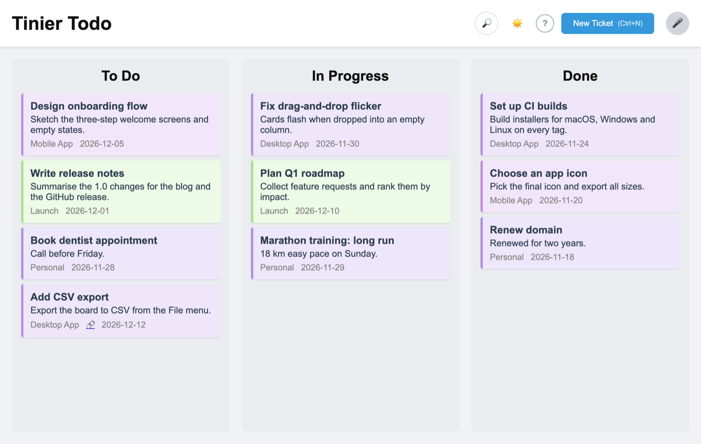

# Tinier Todo

A small, fast Kanban todo app for the desktop. Three columns, drag and drop, dark mode, voice input,
and an optional local MCP server so AI assistants can read and update your board. Built with Go,
[Wails](https://wails.io), React and TypeScript, and runs on macOS, Windows and Linux.



| Dark mode | Ticket details |
|---|---|
|  |  |

## Download

Get the latest build from the [Releases page](../../releases/latest).

| Platform | File |
|---|---|
| macOS (Apple silicon and Intel) | `Tinier-Todo-macOS-universal.zip` |
| Windows 10/11 | `Tinier-Todo-Windows-x64-setup.exe` (installer) or `-portable.zip` |
| Linux x64 | `Tinier-Todo-Linux-x64.tar.gz` |

The builds are not code-signed yet, so your OS will warn you the first time:

- **macOS:** unzip, move **tinier-todo.app** to Applications, then right-click it and choose **Open**.
  If macOS says the app is damaged, run `xattr -dr com.apple.quarantine /Applications/tinier-todo.app`.
- **Windows:** on the SmartScreen prompt, click **More info**, then **Run anyway**.
- **Linux:** needs GTK 3 and WebKitGTK 4.1 (`sudo apt install libgtk-3-0 libwebkit2gtk-4.1-0` on
  Ubuntu/Debian). Extract the archive, then run `./tinier-todo`.

## Features

- **Three-column board:** To Do, In Progress and Done, with drag and drop between columns
- **Tickets:** name, description, project, deadline, link and comments, colour-coded by project
- **Fuzzy search** across titles, descriptions, projects and comments
- **Soft delete:** deleted tickets can be restored from *Tools → Deleted Tickets*
- **Dark mode** (Ctrl+D)
- **Voice input:** dictate a ticket description with speech-to-text, where the platform's web view
  supports the Web Speech API
- **Native menus** and keyboard-first navigation
- **Local MCP server** so AI assistants can manage your tickets (see below)
- **Plain JSON storage:** no account, no cloud, no database

## Keyboard shortcuts

| Shortcut | Action |
|---|---|
| Ctrl+N | New ticket |
| Ctrl+F | Search tickets |
| Ctrl+D | Toggle dark mode |
| Ctrl+/ | Show keyboard shortcuts |
| Ctrl+Shift+N | Start voice input |
| Space | Stop voice input (while recording) |
| Arrow keys / Enter | Move between and open tickets |
| Esc | Close a dialog |

## MCP server

Tinier Todo runs a [Model Context Protocol](https://modelcontextprotocol.io) server so tools like
Claude Code, Claude Desktop or VS Code can work with your board. It listens on
`http://127.0.0.1:3535/sse` (this machine only) and can be switched off, or moved to another port,
under *Tools → MCP*.

Tools: `list_tickets`, `create_ticket`, `edit_ticket`, `move_ticket`, `delete_ticket`,
`list_deleted_tickets` and `restore_ticket`.

For example, with Claude Code:

```bash
claude mcp add --transport sse tinier-todo http://127.0.0.1:3535/sse
```

The server has no authentication, which is why it only accepts connections from your own machine.

## Your data

Everything is stored as JSON in your home folder:

| File | Contents |
|---|---|
| `~/.tinier-todo/tickets.json` | active tickets |
| `~/.tinier-todo/deleted_tickets.json` | deleted tickets |
| `~/.tinier-todo/mcp_settings.json` | MCP server settings |

Back up or sync that folder to keep your board safe.

## Build from source

Requirements: Go 1.23+, Node.js 18+ and the Wails CLI:

```bash
go install github.com/wailsapp/wails/v2/cmd/wails@v2.10.2
wails doctor   # checks platform dependencies
```

Then:

```bash
wails dev      # hot-reload development build
wails build    # production build in build/bin/
```

On Linux with WebKitGTK 4.1 (Ubuntu 24.04 and later), build with `wails build -tags webkit2_41`.

### Releases

`.github/workflows/build.yml` builds the app on macOS, Windows and Linux for every push and pull
request. To publish a release, push a version tag:

```bash
git tag v1.0.0
git push origin v1.0.0
```

The workflow sets the app version from the tag, builds all three platforms and attaches the
downloads to a new GitHub Release.

## Project structure

```
├── main.go                 # app entry point, window and native menus
├── app.go                  # ticket persistence and the methods the UI calls
├── mcp.go                  # local MCP server
├── frontend/src/
│   ├── App.tsx             # board, search, shortcuts, voice input
│   ├── ticketDetails/      # ticket details dialog
│   └── style.css           # styles, including dark mode
├── frontend/wailsjs/       # generated Go ↔ JS bindings
├── build/                  # icons, macOS plist, Windows installer config
└── .github/workflows/      # cross-platform build and release
```

## Contributing

Issues and pull requests are welcome. Please describe the change and how you tested it.

## Licence

[MIT](LICENSE) © 2026 Ritvik Joshi
